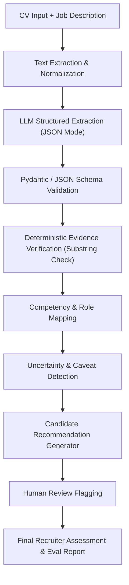

# Product Requirements Document (PRD): SIGNALTRACE
**AI-Powered Candidate Intelligence — Evidence-Driven CV Extraction & Role Matching**

- **Target Submission:** Mini Assignment AI Engineer — Sekolah Karir (Batch 2)
- **Format Naming Target:** `[NamaLengkap]_AIEngineer_SKBatch2`
- **Target Execution Environment:** Antigravity IDE (Agentic Workspace)
- **Estimated Build Time:** 90–120 Menit

---

## 1. Latar Belakang & Tujuan Produk
Proses penyaringan kandidat secara manual memakan waktu tinggi, sementara sistem ATS/AI konvensional sering beroperasi sebagai *black-box* yang mudah berhalusinasi atau membuat keputusan otomatis tanpa transparansi bukti.

**SIGNALTRACE** dirancang untuk membantu tim rekrutmen Sekolah Karir mengekstrak profil kandidat terstruktur dari CV, memetakannya terhadap *Job Description* (JD), melampirkan bukti kutipan langsung (*verbatim evidence*), mengidentifikasi ketidakpastian (*caveats & information gaps*), serta memberikan rekomendasi terukur dengan tetap mewajibkan *human-in-the-loop* (HITL).

### Prinsip Desain Utama
1. **Absence of Evidence ≠ Evidence of Absence:** Informasi yang tidak tercantum di CV tidak boleh diasumsikan sebagai ketidakmampuan kandidat, melainkan dicatat sebagai `information_gaps`.
2. **Evidence-Grounded Extraction:** Setiap klaim kompetensi wajib disertai kutipan teks persis dari CV (`verbatim quote`).
3. **Human-in-the-Loop Decision Support:** AI bertindak sebagai *decision-support assistant*, bukan penentu kelulusan final otomatis.

---

## 2. Alur Sistem (System Architecture Flow)

---

## 3. Spesifikasi Fitur & Fungsionalitas

| Komponen | Deskripsi Teknis | Kriteria Keberhasilan |
| :--- | :--- | :--- |
| **1. CV Extraction** | Mengekstrak identitas, pendidikan, pengalaman kerja/proyek, dan skill ke dalam format JSON ketat. | 100% output lolos validasi JSON Schema tanpa error tipe data. |
| **2. Evidence Tracking** | Menyertakan field `evidence_quote` untuk setiap pengalaman dan skill, lalu memverifikasi secara deterministik apakah kutipan benar-benar ada di teks CV asli. | Sistem menandai `evidence_verified: false` jika kutipan tidak cocok/halusinasi. |
| **3. Role Matching** | Membandingkan kompetensi kandidat terhadap kriteria JD (Required vs Preferred) dan menghitung skor kecocokan berbasis bukti. | Setiap poin kecocokan merujuk pada bukti spesifik, bukan asumsi umum. |
| **4. Uncertainty & Human Review** | Mendeteksi tanggal tumpang tindih (*overlapping dates*), skill tanpa bukti (*unsubstantiated claims*), dan informasi hilang (`information_gaps`), lalu memicu `human_review_required: true`. | Semua edge-case pada mock CV terdeteksi dan masuk ke daftar `caveats`. |
| **5. Multi-Metric Evaluation** | Mengevaluasi sistem secara terpisah pada 5 dimensi: *Extraction Correctness, Evidence Accuracy, Schema Validity, Uncertainty Handling,* dan *Recommendation Quality*. | Laporan evaluasi terpisah per metrik (tidak hanya satu angka akurasi). |

---

## 4. Desain Dataset Uji (3 Skenario Mock CV)
Untuk membuktikan ketangguhan sistem di luar *happy path*, prototype wajib diuji pada 3 profil kandidat terhadap 1 Job Description (**AI & Automation Engineer — Sekolah Karir**):

1. **Skenario A (`cv_01_strong_verified.txt` — Happy Path):** CV lengkap, tanggal konsisten, setiap skill didukung proyek nyata dan metrik terukur.
2. **Skenario B (`cv_02_unsubstantiated_skills.txt` — Skill Tanpa Bukti):** Kandidat mencantumkan banyak buzzword (LLM, RAG, Python, LangChain) di bagian *Skills*, tetapi riwayat pengalaman hanya berisi pekerjaan administratif umum tanpa bukti teknis.
3. **Skenario C (`cv_03_ambiguous_overlap.txt` — Tanggal Tumpang Tindih & Ambigu):** Memiliki dua pekerjaan penuh waktu di periode waktu yang bertabrakan, periode kerja tanpa bulan yang jelas, dan klaim dampak yang tidak terverifikasi.

---

## 5. Kriteria Penilaian Assignment (Alignment Check)
- **AI System Design:** Pemisahan tahap ekstraksi LLM dengan validasi deterministik (Python string matching & schema validator).
- **Structured Output:** Penggunaan Pydantic / JSON Schema dengan field reasoning (`evidence`, `confidence`, `information_gaps`, `caveats`).
- **Safety & Oversight:** Mekanisme pencegah halusinasi dan flag `human_review_required`.
- **Evaluation Thinking:** Framework evaluasi 5 metrik terukur dengan membandingkan hasil terhadap *Ground Truth*.
- **AI Tool Usage Disclosure:** Menyertakan dokumentasi transparan mengenai penggunaan Antigravity & LLM dalam membangun solusi.
