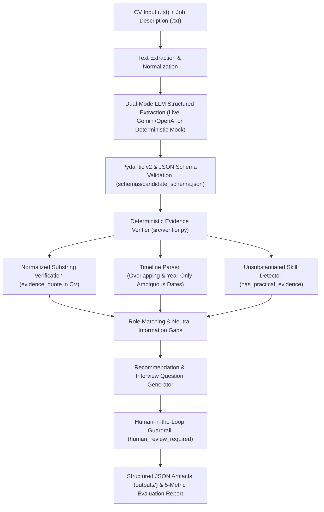

# SIGNALTRACE — AI-Powered Candidate Intelligence
**Evidence-Driven CV Extraction, Deterministic Verification & Role Matching**

- **Submission:** Mini Assignment AI Engineer — Sekolah Karir (Batch 2)
- **Author:** Ergy David Lundy Tumanggor
- **Target Role Evaluated:** AI & Automation Engineer — Sekolah Karir

---

## 1. Architecture Note & Keputusan Desain

Sistem penyaringan CV berbasis AI konvensional sering beroperasi sebagai *black-box* yang rentan berhalusinasi, memberikan skor tunggal tanpa bukti kutipan, atau mendiskualifikasi kandidat secara sepihak hanya karena suatu informasi tidak tertulis eksplisit di CV.

**SIGNALTRACE** dirancang dengan arsitektur **Hybrid Neuro-Symbolic (LLM Extraction + Deterministic Python Verification)** yang memisahkan proses ekstraksi bahasa alami dari proses validasi kebenaran bukti.

### Diagram Alur Arsitektur Sistem



### Tiga Prinsip Desain Utama
1. **Absence of Evidence $\neq$ Evidence of Absence (`information_gaps`):**
   Jika kriteria pada *Job Description* (misalnya *Vector Database* atau *RAG*) tidak tertulis di dalam CV, sistem **dilarang** menyimpulkan kandidat tidak mampu. Sistem mencatatnya secara netral di `information_gaps` dan menghasilkan pertanyaan konfirmasi pada `suggested_interview_questions`.
2. **Evidence-Grounded Extraction & Deterministic Substring Verification (`src/verifier.py`):**
   Setiap entri pada `education`, `experience`, dan `skills` wajib menyertakan `evidence_quote`. Nilai boolean `evidence_verified` **tidak pernah dipercaya langsung dari output LLM**, melainkan dihitung ulang secara deterministik menggunakan pencocokan substring ter-normalisasi (`normalize_text`). Jika kutipan meleset atau halusinasi, `verifier.py` otomatis mengubah `evidence_verified = False`, menurunkan `confidence = "low"`, dan menyuntikkan peringatan `"Unverified extraction quote detected by deterministic verifier"` ke dalam `caveats`.
3. **Human-in-the-Loop Decision Support (`human_review_required`):**
   AI bertindak sebagai asisten pendukung keputusan (*decision-support*), bukan penentu kelulusan otomatis. Flag `human_review_required` secara otomatis bernilai `True` apabila ditemukan `caveats`, `information_gaps`, klaim tanpa bukti praktis, kutipan gagal verifikasi, atau skor di area abu-abu.

---

## 2. Struktur Direktori Proyek

```text
ErgyDavidLundyTumanggor_AIEngineer_SKBatch2/
├── README.md                          # Dokumentasi arsitektur, cara jalan, evaluasi & AI disclosure
├── PRD.md                             # Product Requirements Document
├── ANTIGRAVITY_INSTRUCTIONS.md        # Spesifikasi tahapan implementasi
├── requirements.txt                   # Daftar dependensi Python
├── schemas/
│   └── candidate_schema.json          # JSON Schema ketat untuk validasi output
├── prompts/
│   └── extraction_system_prompt.md    # System prompt anti-halusinasi untuk LLM
├── mock_data/
│   ├── job_description.txt            # JD target: AI & Automation Engineer - Sekolah Karir
│   ├── cv_01_strong_verified.txt      # Skenario 1: Kandidat kuat dengan bukti proyek & metrik nyata
│   ├── cv_02_unsubstantiated.txt      # Skenario 2: Banyak keyword AI di daftar skill tanpa bukti pengalaman
│   ├── cv_03_ambiguous_overlap.txt    # Skenario 3: Tanggal kerja full-time tumpang tindih, ambigu & halusinasi
│   └── ground_truth_eval.json         # Ground truth evaluasi untuk 3 skenario
├── src/
│   ├── __init__.py
│   ├── models.py                      # Pydantic v2 models & JSON Schema loader
│   ├── pipeline.py                    # Dual-mode LLM client (Live/Mock) & orkestrasi pipeline
│   ├── verifier.py                    # Verifikasi kutipan verbatim & deteksi anomali tanggal/skill
│   └── evaluator.py                   # Evaluator 5 metrik terpisah & generator laporan Markdown
├── tests/
│   └── test_signaltrace.py            # Suite unit test & integration test (pytest)
├── outputs/
│   ├── sample_output_cv01.json        # Output JSON terverifikasi untuk CV 01
│   ├── sample_output_cv02.json        # Output JSON terverifikasi untuk CV 02
│   ├── sample_output_cv03.json        # Output JSON terverifikasi untuk CV 03
│   └── evaluation_report.md           # Laporan lengkap evaluasi 5 metrik
└── main.py                            # CLI entry point utama
```

---

## 3. Cara Menjalankan Prototype

### Prasyarat & Instalasi
Gunakan Python 3.10+ dan virtual environment:

```powershell
# 1. Buat dan aktifkan virtual environment
python -m venv .venv
.\.venv\Scripts\Activate.ps1

# 2. Instal dependensi
pip install -r requirements.txt
```

### Menjalankan Pipeline & Evaluasi (Default Mock Mode — Tanpa API Key)
Secara default, kode berjalan menggunakan **Deterministic Mock LLM Mode** sehingga reviewer dapat langsung menjalankan seluruh alur ekstraksi, verifikasi deterministik, dan evaluasi 5 metrik tanpa memerlukan API Key berbayar:

```powershell
python main.py
# atau secara eksplisit:
python main.py --mode mock
```

### Menjalankan dengan Live LLM API (Opsional)
Apabila ingin menguji menggunakan koneksi API langsung (mendukung Google Gemini API `gemini-3.8-flash` melalui `google-genai` SDK maupun OpenAI API):

```powershell
$env:GEMINI_API_KEY="your_api_key_here"
python main.py --mode live
```
*(Jika API key tidak ditemukan, sistem memiliki graceful fallback ke mode `mock` agar eksekusi tidak gagal).*

### Menjalankan Unit Tests
```powershell
pytest -v
```

---

## 4. Ringkasan Sample Input/Output & Analisis Kegagalan AI (`Caveats`)

Prototype diuji terhadap 3 skenario kandidat untuk posisi **AI & Automation Engineer — Sekolah Karir**:

| Skenario | Kandidat | Skor Match | Verbatim Quotes | Anomali & Caveats yang Ditangkap | Rekomendasi |
| :--- | :--- | :-: | :-: | :--- | :--- |
| **Skenario 1** (`cv_01_strong_verified.txt`) | **Nadya Putri Maharani** | `90/100` | `8/8` (100%) | Bukti sangat kuat (Python, Gemini API, JSON terstruktur 1.200+ dokumen, penurunan error halusinasi 18% ke 3%, otomasi n8n). Memiliki *information gap* minor pada preferred skill *Vector Database* & *RAG*. | `proceed_to_interview` (`human_review_required: true`) |
| **Skenario 2** (`cv_02_unsubstantiated.txt`) | **Dimas Arya Pratama** | `28/100` | `10/10` (100%) | **Keyword Stuffing / Unsubstantiated Skills:** Mencantumkan `Python`, `LangChain`, `RAG`, `OpenAI API`, `Prompt Engineering`, `Vector Database` di bagian *Keahlian*, tetapi pengalaman kerja hanya admin Excel & CS. Enam skill ditandai `has_practical_evidence: false` dan `confidence: "low"`. | `proceed_with_verification` (`human_review_required: true`) |
| **Skenario 3** (`cv_03_ambiguous_overlap.txt`) | **Raka Wijaya Kusuma** | `58/100` | `7/8` (87.5%) | **Multi-Anomaly & Hallucination Catch:** (1) Dua peran *Full-time* bertabrakan selama 8 bulan (`Mar 2023 - Okt 2023`), (2) Tanggal freelance ambigu hanya tahun (`2022 - 2023`), (3) Klaim efisiensi subjektif tanpa metrik, dan (4) **1 kutipan halusinasi LLM (`"sebesar 45%"`) berhasil ditangkap oleh `verifier.py`**. | `hold_for_human_review` (`human_review_required: true`) |

### Studi Kasus Analisis Kegagalan AI: Bagaimana `verifier.py` Menangkap Halusinasi pada CV 03
Pada Skenario 3 (`cv_03_ambiguous_overlap.txt`), teks asli CV tertulis:
> `- Mengembangkan chatbot layanan pelanggan menggunakan Python dan OpenAI API.`
> `- Meningkatkan efisiensi operasional perusahaan secara signifikan melalui otomasi AI.`

Dalam simulasi ekstraksi LLM pada `experience[0]`, LLM melakukan halusinasi dengan menggabungkan kalimat dan mengarang angka metrik palsu:
> `"evidence_quote": "Mengembangkan chatbot layanan pelanggan menggunakan Python dan OpenAI API serta meningkatkan efisiensi operasional perusahaan sebesar 45% melalui otomasi AI."`

Ketika output LLM melewati `verify_candidate_assessment()` di `src/verifier.py`:
1. Fungsi `is_verbatim_substring()` mendeteksi bahwa kutipan tersebut **tidak ada** di teks CV asli.
2. Field `evidence_verified` diubah paksa dari `True` menjadi `False`.
3. Field `confidence` diturunkan dari `"high"` menjadi `"low"`.
4. Peringatan eksplisit ditambahkan ke `caveats`:
   `Unverified extraction quote detected by deterministic verifier [experience: Full-time AI Engineer at PT Solusi Cerdas Digital]`
5. Flag `human_review_required` dikunci pada `True` dan status rekomendasi diarahkan ke `hold_for_human_review`.

---

## 5. Hasil Evaluasi 5 Metrik Terpisah

Laporan lengkap tersedia pada `outputs/evaluation_report.md`. Sesuai prinsip evaluasi multi-dimensi, kelima metrik dilaporkan secara terpisah:

| # | Metrik Evaluasi | Hasil Skor | Rasio Lulus | Interpretasi |
| :-: | :--- | :-: | :-: | :--- |
| 1 | **`schema_validity`** | **100.00%** | `3 / 3` CV | Seluruh output lolos validasi Pydantic v2 (`extra="forbid"`) dan `schemas/candidate_schema.json`. |
| 2 | **`extraction_correctness`** | **100.00%** | `15 / 15` Checks | Nama kandidat, kontak, pendidikan, target role, dan jumlah pengalaman 100% sesuai `ground_truth_eval.json`. |
| 3 | **`evidence_accuracy`** | **96.15%** *(Raw Quote)* / **100.00%** *(Verifier)* | `25 / 26` Verbatim (`26 / 26` Verified Flags) | 25 dari 26 kutipan merupakan substring verbatim asli, sementara 1 kutipan halusinasi pada CV 03 berhasil dideteksi 100% akurat oleh `verifier.py` (`evidence_verified = False`). |
| 4 | **`uncertainty_handling`** | **100.00%** | `15 / 15` Checks | Seluruh *edge-case* (skill tanpa bukti di CV 02, tanggal tumpang tindih & tahun ambigu di CV 03, halusinasi kutipan, `information_gaps` netral, dan `human_review_required`) terdeteksi 100%. |
| 5 | **`recommendation_quality`** | **100.00%** | `9 / 9` Checks | Seluruh status rekomendasi (`proceed_to_interview`, `proceed_with_verification`, `hold_for_human_review`) cocok dengan *ground truth* dan dilengkapi pertanyaan wawancara spesifik. |

---

## 6. AI & Tools Usage Disclosure

Sesuai dengan kebijakan transparansi penggunaan AI pada brief (*Tools & AI Policy*):

- **Tools yang Digunakan:**
  1. **Google Gemini:** Digunakan pada tahap perencanaan awal untuk menerjemahkan konsep dasar (*SIGNALTRACE*) dan *brief assignment* menjadi dokumen spesifikasi teknis (`PRD.md`), skema data (`schemas/candidate_schema.json`), *system prompt* (`prompts/extraction_system_prompt.md`), dataset sintetis (`mock_data/`), serta instruksi kerja agen (`ANTIGRAVITY_INSTRUCTIONS.md`).
  2. **Antigravity IDE (Agentic Coding Environment):** Digunakan untuk mengeksekusi instruksi spesifikasi tersebut secara otomatis (*end-to-end code generation*) menjadi modul Python (`src/`), pengujian otomatis (`tests/`), dan artefak keluaran (`outputs/`).

- **Bagaimana AI Membantu & Peran Kandidat (Spec-Driven Workflow):**
  - **Otomasi Penulisan Kode & Dokumen:** Seluruh implementasi kode Python (`models.py`, `pipeline.py`, `verifier.py`, `evaluator.py`, `main.py`) dan dataset uji di-generate menggunakan bantuan AI berdasarkan *blueprint* arsitektur yang diberikan.
  - **Peran Kandidat (Orkestrasi, Review & Pemahaman Sistem):** Menentukan arah desain awal (4 pilar *SIGNALTRACE*: *CV Extraction, Evidence Tracking, Role Matching, Human Review*), mengarahkan pembuatan skenario uji *edge-case*, memeriksa kesesuaian output JSON dan laporan evaluasi terhadap syarat tugas, serta mempelajari alur kerja sistem secara menyeluruh untuk memastikan seluruh hasil dapat dipertanggungjawabkan.